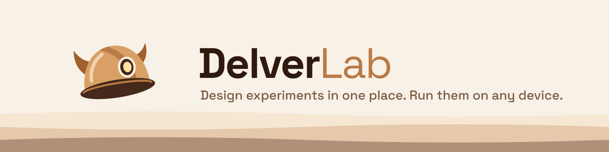

<picture>
  <source media="(prefers-color-scheme: dark)" srcset="assets/delverlab-banner-dark.png">
  
</picture>

**DelverLab** is an open-source, self-hostable platform for running research experiments.

Researchers describe an experiment once in a central web app: its variables, conditions and structure. Devices then run the sessions and send the collected data back to the server, even if they were offline during the session. We're starting with XR experiments built in Unity, but the platform isn't limited to XR.

DelverLab started at **LabCG** and is in early development. More information is coming as the first components are released.
